# AQX Trader demo – defects

Defects found in the AQX Trader web demo while building the suite, with how each one was
confirmed, how to reproduce it by hand and a screenshot of it. Only behaviour that was actually
seen is listed as a defect; anything that is only suspected is kept apart under
[Needs confirmation](#needs-confirmation) and is not counted.

## How the list was checked

- **When:** 2026-11-08, by hand at about 06:00–06:10 server time (GMT+2), screenshots at about
  09:15–09:25. Every market was closed.
- **Account:** the suite's demo account, with no open positions, no pending orders and no trades
  in its history (only the opening deposit). One-Click Trading off.
- **Browser:** Chromium, Trade tab, symbol EURUSD (Bid 1.1138 / Ask 1.1141 all day, as the
  market was closed).
- **Screenshots:** taken by `npm run defects:screenshots`
  ([scripts/defect-screenshots/capture.spec.ts](../scripts/defect-screenshots/capture.spec.ts))
  at 1600×1200 and double pixel density. The red boxes are drawn over the page for the picture
  only. The script never places an order, re-checks each defect before its picture and fails if
  one has been fixed, so the pictures can be taken again at any time.
- **Limit:** while the market is closed the place button reads "Market Closed" and cannot be
  clicked. The live checks therefore show what the **order form** does; whether the server would
  also refuse the order was not checked and is noted where it matters.

| Status             | Meaning                                                                                                                                          |
| ------------------ | ------------------------------------------------------------------------------------------------------------------------------------------------ |
| Confirmed live     | Reproduced by hand on the real demo with the steps below                                                                                         |
| Mocked only        | Seen in the real web app with the server's replies replaced (`tests/mocked`). The browser's part is the app's own; the server's part is unproven |
| Needs confirmation | Only in notes or page-object comments; not reproduced. Not a defect until it is                                                                  |

| Severity | Meaning                                                                         |
| -------- | ------------------------------------------------------------------------------- |
| High     | Can open or change a trade the user did not ask for                             |
| Medium   | Validation the user relies on is missing, so a wrong order can reach the server |
| Low      | Misleading or inconsistent display; no wrong trade on its own                   |

## Summary

| ID     | Defect                                                                | Severity | Req.   | Status                  | Test that shows it                    |
| ------ | --------------------------------------------------------------------- | -------- | ------ | ----------------------- | ------------------------------------- |
| DEF-01 | A double-click on One-Click BUY sends two orders                      | High     | R2     | Mocked only             | TC-OCT-08 (`test.fail`)               |
| DEF-02 | A Stop Loss of 0 is accepted and treated as "no Stop Loss"            | Medium   | R1     | Confirmed live (form)   | –                                     |
| DEF-03 | The stops level is not checked in the order form                      | Medium   | R1     | Confirmed live (form)   | TC-MKT-10 (trading, not yet run)      |
| DEF-04 | A pending price on the wrong side of the market, or 0, is accepted    | Medium   | R3     | Confirmed live (form)   | TC-PND-09 (trading, not yet run)      |
| DEF-05 | An invalid volume is silently replaced when the user leaves the field | Medium   | R1     | Confirmed live          | TC-MKT-11 (records current behaviour) |
| DEF-06 | Trade Details mix the Bid and the Ask                                 | Low      | R1, R3 | Confirmed live          | TC-MKT-04/05 (work around it)         |
| DEF-07 | The expiry time picker offers hours that have already passed          | Low      | R3     | Confirmed live (picker) | –                                     |
| DEF-08 | "Specified Date and Time" expiry defaults to the current time         | Low      | R3     | Confirmed live          | –                                     |
| DEF-09 | Margin Level shows 0.00% when no margin is used                       | Low      | R7     | Confirmed live          | TC-DTL-04 (records current behaviour) |
| DEF-10 | Bulk Close / Bulk Delete give no feedback on an empty list            | Low      | R5     | Confirmed live          | TC-BLK-07 (records current behaviour) |

"Records current behaviour" means the test asserts what the app does today, so it passes; the
expected result in [testcase-final.md](testcase-final.md) is the one quoted under each defect.

## Defects

### DEF-01 A double-click on One-Click BUY sends two orders

**Severity:** High · **Req.:** R2 · **Status:** Mocked only

While the first order request is unanswered, the One-Click BUY button stays enabled and shows
no busy state. A second click sends a second `POST /api/trade/trade/v1/market`. On a slow
connection a double-click could therefore open two positions.

Steps (needs an open market and One-Click Trading on):

1. In DevTools > Network, set throttling to a slow profile (e.g. "3G") so the reply takes
   longer than a double-click.
2. On the One Click tab, set Volume to 0.01 and double-click BUY.
3. Count the requests to `/api/trade/trade/v1/market` and the rows in Open Positions.

- **Expected:** one request; the button is disabled or busy until the reply arrives.
- **Actual (mocked):** two requests. TC-OCT-08 (`tests/mocked/one-click.spec.ts`) holds back the
  reply to the first order and expects a single request; it fails, so it is marked `test.fail`.
- **Not checked:** whether the server then opens two positions.
- **Screenshot:** none; on the live demo it needs an open market and One-Click Trading on.

### DEF-02 A Stop Loss of 0 is accepted and treated as "no Stop Loss"

**Severity:** Medium (High if the server opens the position without a stop) · **Req.:** R1 ·
**Status:** Confirmed live (form)

Steps (EURUSD, Trade tab):

1. Order Type Market, BUY, Volume 0.01.
2. In Stop Loss Price type `0` and press Tab.

- **Expected:** an error, as for a Stop Loss above the price ("Stop Loss must be less than Sell
  Price."), or the field cleared, so the user can see that no stop is set.
- **Actual:** the field shows `0.0000` and Points `11138`, with no message. Trade Details show
  Potential Loss `0.00` and an empty Risk:Reward, exactly as with no Stop Loss.
- **Note:** a missing SL/TP is sent to the server as 0 (seen in the mocked tests, see
  [platform-notes.md](platform-notes.md)), so a typed 0 most likely reaches the server as "no
  Stop Loss". Not checked with an open market.

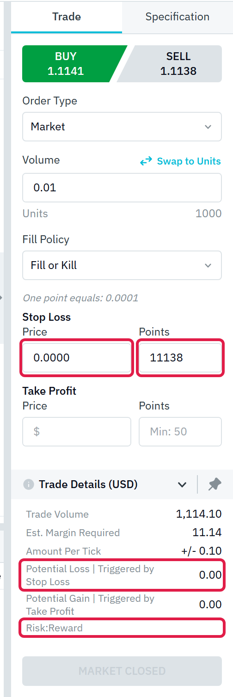

### DEF-03 The stops level is not checked in the order form

**Severity:** Medium · **Req.:** R1 · **Status:** Confirmed live (form)

Steps (EURUSD, Bid 1.1138):

1. Order Type Market, BUY, Volume 0.01. The Points fields say `Min: 50`.
2. In Stop Loss Price type a price 8 points below the Bid (`1.1130`) and press Tab.

- **Expected:** a message, since the form itself says the minimum distance is 50 points
  (TC-MKT-10 expects the order to be refused).
- **Actual:** Points shows `8`; no message. Trade Details even work out the loss at that stop.
- **Not checked:** whether the form or the server refuses it on submit (market closed). TC-MKT-10
  in the `trading` project checks the server's answer once the market is open.

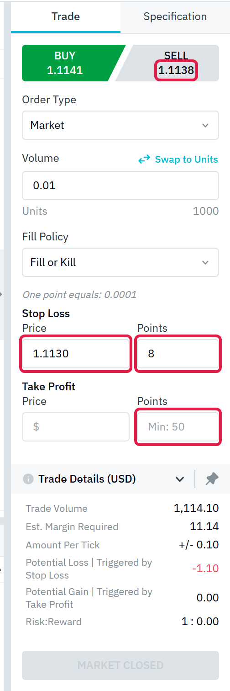

### DEF-04 A pending price on the wrong side of the market, or 0, is accepted

**Severity:** Medium · **Req.:** R3 · **Status:** Confirmed live (form)

Steps (EURUSD, Ask 1.1141):

1. Order Type Limit, BUY, Volume 0.01.
2. In Price type `1.1200` (above the Ask) and press Tab: no message.
3. In Price type `0` and press Tab: the field shows `0.0000`, Trade Volume and Est. Margin
   Required show `0.00`, and there is no message.

- **Expected:** a Buy Limit must be below the Ask, and a price must be above 0; both should be
  refused in the form, as a Stop Loss on the wrong side is.
- **Not checked:** the stop/limit relation of a Stop Limit order, and the server's answer
  (TC-PND-09 in the `trading` project expects a refusal).

| Buy Limit at 1.1200, above the Ask 1.1141                                                                             | Price 0                                                                                                                      |
| --------------------------------------------------------------------------------------------------------------------- | ---------------------------------------------------------------------------------------------------------------------------- |
| 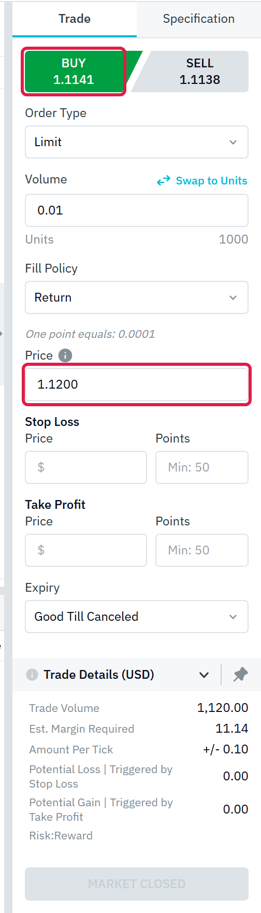 | 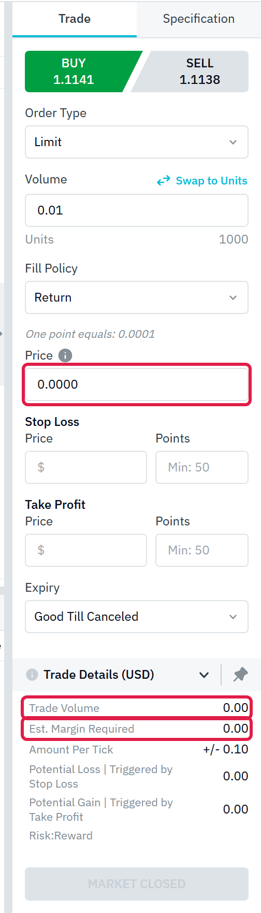 |

### DEF-05 An invalid volume is silently replaced when the user leaves the field

**Severity:** Medium · **Req.:** R1 · **Status:** Confirmed live

Steps (EURUSD, Order Type Market):

1. In Volume type `0.015`. While typing, the form says "Please enter a valid volume." (Units
   1500).
2. Press Tab: the volume becomes `0.01` (Units 1000) and the message disappears.
3. In Volume type `101` and press Tab: it becomes `100` (Units 10000000), with no message.

- **Expected (TC-MKT-11):** values that are not allowed are "blocked by the input or rejected
  with a message". A volume below the minimum does this (`0.001` keeps its value and shows
  "Minimum volume is 0.01.").
- **Actual:** a value the form itself flags as invalid is replaced by another one when the user
  leaves the field, and the message goes away, so the user can place a different size from the
  one typed. TC-MKT-11 (`tests/terminal/order-entry.spec.ts`) asserts this behaviour.

| Typing `0.015`                                                                                                     | After Tab                                                                                                              | `101` after Tab                                                                             |
| ------------------------------------------------------------------------------------------------------------------ | ---------------------------------------------------------------------------------------------------------------------- | ------------------------------------------------------------------------------------------- |
| 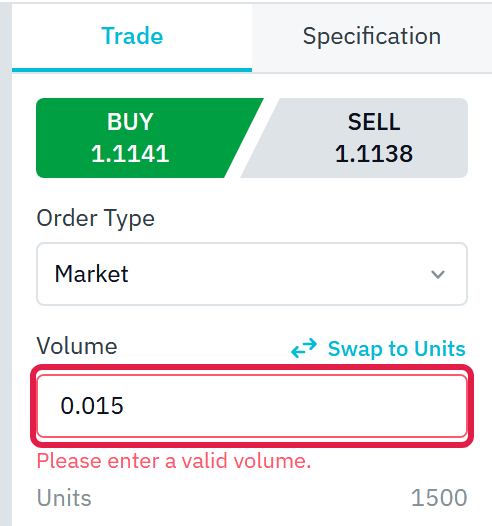 |  | 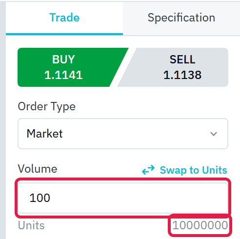 |

### DEF-06 Trade Details mix the Bid and the Ask

**Severity:** Low · **Req.:** R1, R3 · **Status:** Confirmed live

Steps (EURUSD, Bid 1.1138 / Ask 1.1141):

1. Order Type Market, SELL, Volume 5: Trade Volume `556,900.00` (Bid) but Est. Margin Required
   `5,570.50`, which is 557,050 / 100 (Ask).
2. Click BUY without retyping the volume: Trade Volume stays `556,900.00` (the Ask gives
   557,050.00). It changes only when the volume is typed again.
3. Order Type Limit, BUY, Volume 5, Price `1.1200`: Trade Volume `560,000.00` (the order price)
   but Est. Margin Required `5,570.50` (the market Ask).

- **Expected:** Trade Volume and Est. Margin Required use the same price (the side's price for a
  market order, the order price for a pending order) and follow a change of side.
- **Note:** the Trade Details checks of TC-MKT-04/05 pick the side before typing the volume and
  accept a margin between the Bid- and Ask-based values to work around this.

| 1. SELL: margin from the Ask                                                                                                | 2. BUY: Trade Volume still from the Bid                                                                                  | 3. Limit: margin from the market, not the order price                                                                                       |
| --------------------------------------------------------------------------------------------------------------------------- | ------------------------------------------------------------------------------------------------------------------------ | ------------------------------------------------------------------------------------------------------------------------------------------- |
| 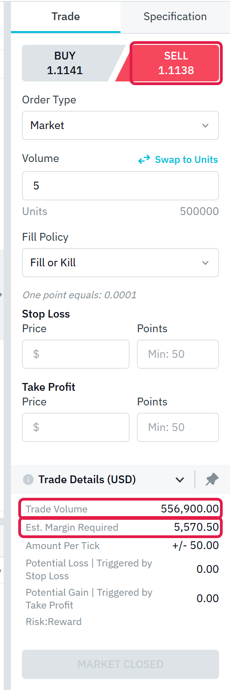 | 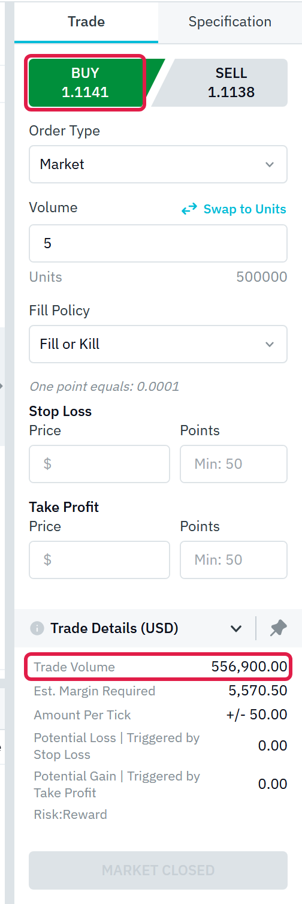 | 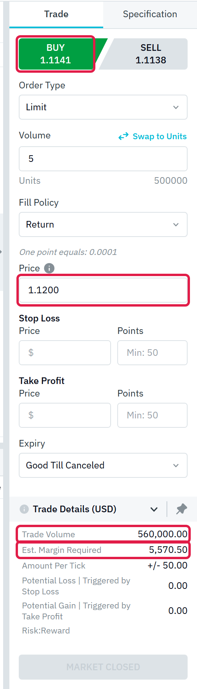 |

### DEF-07 The expiry time picker offers hours that have already passed

**Severity:** Low · **Req.:** R3 · **Status:** Confirmed live (picker)

Steps:

1. Order Type Limit, Expiry "Specified Date and Time". The date is today.
2. Open the time picker and the Hour list.

- **Expected:** hours before the current server time are disabled, as past days are in the
  calendar (TC-PND-15).
- **Actual:** hours that have passed look like later hours and none is marked disabled (checked
  at 06:03 and at 09:21 server time; the screenshot shows 00–05 at 09:21).
- **Not checked:** the server's answer to an expiry in the past.

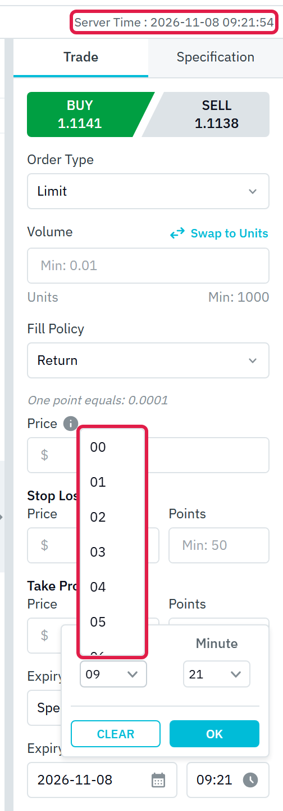

### DEF-08 "Specified Date and Time" expiry defaults to the current time

**Severity:** Low · **Req.:** R3 · **Status:** Confirmed live

Steps: Order Type Limit, then Expiry "Specified Date and Time".

- **Expected:** a default in the future (for example the end of the day), or empty fields the user
  must fill.
- **Actual:** the fields are set to the current server date and minute (`2026-11-08` `06:02` at
  06:02:40, `09:19` at 09:19:42), a time that has passed by the time the order could be sent.

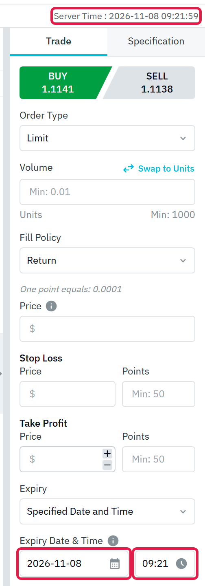

### DEF-09 Margin Level shows 0.00% when no margin is used

**Severity:** Low · **Req.:** R7 · **Status:** Confirmed live

Steps: on an account with no open positions, read Margin Level in the header, then open the
account menu (Margin Used $0.00).

- **Expected (TC-DTL-04):** "margin level is empty/'–' while used margin is 0". Margin Level is
  equity ÷ used margin, which is undefined with no margin.
- **Actual:** `0.00%`, which reads as an account about to be stopped out. TC-DTL-04
  (`tests/terminal/records.spec.ts`) asserts the current value.

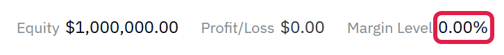

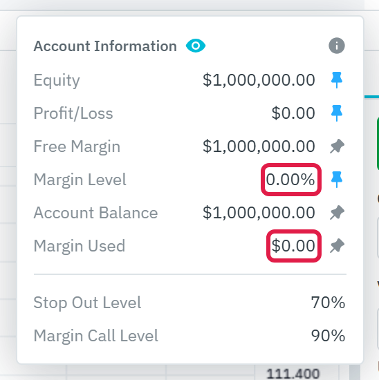

### DEF-10 Bulk Close / Bulk Delete give no feedback on an empty list

**Severity:** Low · **Req.:** R5 · **Status:** Confirmed live

Steps:

1. With Open Positions (0), click Bulk Close.
2. With Pending Orders (0), click Bulk Delete.

- **Expected (TC-BLK-07):** "action disabled or a 'nothing to close' message".
- **Actual:** the buttons look enabled; nothing opens, no message appears and no request is sent.
  TC-BLK-07 (`tests/terminal/bulk.spec.ts`) asserts this for both buttons. The screenshot is
  taken 1.5 s after clicking Bulk Close.

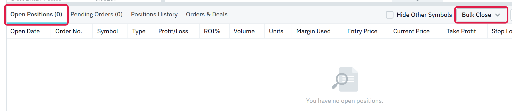

## Needs confirmation

Seen only in notes, page-object comments or tests with made-up server data. Each needs the
listed check before it can be reported.

| #   | Observation                                                                                                           | Where it comes from                                                                                                                                                                         | What would confirm it                                                   |
| --- | --------------------------------------------------------------------------------------------------------------------- | ------------------------------------------------------------------------------------------------------------------------------------------------------------------------------------------- | ----------------------------------------------------------------------- |
| N-1 | An order request that never gets an answer shows nothing for a long time (no time-out)                                | Comment in `src/helpers/mockMarket.ts`; seen only with a mock that never answers                                                                                                            | A proxy that holds the order request on an open market                  |
| N-2 | An HTTP 200 reply with an error code in its body is shown as a success                                                | Comment in `src/helpers/mockMarket.ts`; the suite guards against it (`src/pages/components/tradeRequests.ts`)                                                                               | A real refusal from the server, to see how it is wrapped                |
| N-3 | The Close dialog accepts volumes below the minimum or off the step (0.005, 0.015)                                     | Comment in `src/pages/components/ClosePositionDialog.ts`; no test asserts it                                                                                                                | An open position; type both values in the Close dialog                  |
| N-4 | The order form resets when One-Click Trading is switched in another session of the account                            | The page objects re-read and refill the form (`src/pages/components/OrderPanel.ts`)                                                                                                         | Two sessions; switch One-Click Trading in one while typing in the other |
| N-5 | Order Details shows Units "0" for a close whose history row shows 6,000                                               | Annotation in TC-DTL-09 (`tests/mocked/records.spec.ts`); the details reply there is made up                                                                                                | Order Details of a real closed position                                 |
| N-6 | Number formats differ between columns (commission with price digits, a zero swap as "--")                             | Mocked history with made-up values (`tests/mocked/records.spec.ts`); the account has no trades yet                                                                                          | A real closed position in Positions History and Orders & Deals          |
| N-7 | Positions History and Orders & Deals list only the newest 30 records, with no paging, so older ones cannot be reached | TC-HIS-13 (`tests/mocked/records.spec.ts`, marked `test.fail`) with 75 made-up records. Whether the app pages depends on how the real server answers a long history, which the mock invents | An account with more than 30 records in each tab                        |

## Checked and not counted

- **Prices with extra decimals are rounded without a message** (USDSGD Stop Loss `1.2700049`
  becomes `1.27000`). TC-MKT-14 accepts rounding to the symbol's digits as a valid result.
- **The order form clears when the symbol changes.** Expected: the new symbol has its own rules.
